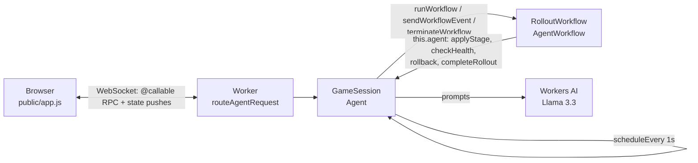

# Fail Small

**A game about shipping config changes without breaking the internet.**

You're the release engineer. Each level is a config change ticket. Pick a rollout plan, deploy it to a simulated
fleet of 20 edge datacenters, and decide at every stage whether to proceed or roll back. An AI co-pilot
(Llama 3.3 on Workers AI) reviews the change and comments on the health data, but it can be wrong.
Your score is the **blast radius**: % of global requests failing × seconds. Keep it small.

I started this after reading Cloudflare's [Code Orange: Fail Small](https://blog.cloudflare.com/fail-small-resilience-plan/)
posts (health-mediated config rollouts, fail-stale defaults, treating config like code) and wanting to feel those
ideas from the release engineer's seat. It turned into a small incident simulator: you rehearse the outages that
start with a routine config push (a bad feature file, a regex that slowly eats CPU, a change that only breaks one
region) somewhere the only thing that goes down is your score. It works as a solo puzzle, as a way to show new SREs
why staged rollouts matter, or as a warm-up before a game day.

## Quick start

```bash
git clone https://github.com/xhoi12/fail-small.git && cd fail-small
npm install
npm start          # → http://localhost:8787
```

That's it. No Cloudflare account needed: the agent, the Workflow and the UI all run locally under `wrangler dev`.

### Optional: turn on the real AI co-pilot

Everything except the LLM runs on your machine. Workers AI runs on Cloudflare's GPUs even during local dev, so the
co-pilot needs a (free) Cloudflare account to call Llama 3.3:

```bash
npx wrangler login   # opens a browser to authorize Wrangler; one time only
npm start
```

`npm start` checks whether you're logged in and picks the mode for you:

| | Co-pilot | Needs |
|---|---|---|
| **Not logged in** | Scripted reviews for each level; free-form chat is limited | Nothing |
| **Logged in** | Llama 3.3 on Workers AI: reviews, stage-by-stage advice, chat, debriefs | A free Cloudflare account (Workers AI free tier is plenty) |

The pill in the co-pilot panel shows which one you're talking to.

## How to play

The game shows these rules on your first visit (and under **How to play** in the top bar), and a banner above the
ticket tells you what to do next at every point of a rollout.

1. Read the ticket and the config diff. The co-pilot posts a pre-flight review.
2. Choose a **strategy** (big bang / fast / staged), a **canary datacenter** and a **bake time**.
3. **Deploy.** Each stage applies the config, bakes, then runs a health check. If any datacenter is over a 10% error
   rate, the health gate rolls back automatically.
4. After each stage, it's your call: **proceed** or **roll back**. You can also chat with the co-pilot
   ("why is SYD elevated?") or type `deploy`, `proceed`, `rollback`, `status`, `review`.
5. Toggle **Fail stale** to make datacenters validate configs and keep their last known-good version.

Bad changes must end rolled back; good changes must reach 100%. The grade comes from the blast radius, and big-bang
deploys cap at B because getting lucky isn't engineering.

| # | Level | What it teaches |
|---|-------|-----------------|
| 1 | Routine Change | Not every change is a trap; rolling back a good change is a failure too |
| 2 | The Feature File | Configs are code: validate them, and fail stale ([inspired by Nov 18, 2025](https://blog.cloudflare.com/18-november-2025-outage/)) |
| 3 | Catastrophic Backtracking | Some failures take time to show; bake long enough ([inspired by Jul 2, 2019](https://blog.cloudflare.com/details-of-the-cloudflare-outage-on-july-2-2019/)) |
| 4 | Works On My Region | A canary only proves what it can see |
| 5 | Below The Gate | Automated gates catch big failures, not every failure |

## How it's built

It was also an excuse to try Cloudflare's agent stack end to end: the
[Agents SDK](https://developers.cloudflare.com/agents/), Workers AI and Workflows.

| Piece | How |
|---|---|
| **Agent** | `GameSession` extends the SDK's `Agent` class ([`src/game.ts`](src/game.ts)), one instance per player, routed with `routeAgentRequest` at `/agents/game-session/<player-id>`. It uses the SDK's persisted state, SQL, scheduling, WebSocket connections, `@callable()` RPC and Workflow integration. |
| **LLM** | Llama 3.3 70B (`@cf/meta/llama-3.3-70b-instruct-fp8-fast`) on Workers AI. It does the pre-flight review of the diff, commentary after each stage, free-form chat, and a blameless debrief. See [`src/copilot.ts`](src/copilot.ts). |
| **Rollouts** | Each rollout is a **Cloudflare Workflow** ([`src/workflow.ts`](src/workflow.ts)) that extends the SDK's `AgentWorkflow`. The agent starts it with `runWorkflow()`, and the workflow calls back through `this.agent`: `step.do` apply → `step.sleep` bake → `step.do` health check → automatic rollback, or `step.waitForEvent` for the player's decision, which the agent sends with `sendWorkflowEvent()`. |
| **Chat** | Chat UI served with Workers Static Assets ([`public/`](public/)), connected to the agent over WebSockets. Buttons and chat call the agent's `@callable()` methods (`deploy`, `proceed`, `rollbackNow`, `chat`, …) over the SDK's WebSocket RPC. Commands and free-form questions both work. |
| **Memory / state** | Agent state (`this.setState`, persisted in the agent's SQLite): fleet, last known-good configs, the active rollout, scores, and a rolling memory of past rollouts that is fed back to the co-pilot ("last time you skipped the canary…"). Chat history lives in a `messages` table via `this.sql`. |

## Architecture



- The **agent holds all state**; the **Workflow only coordinates**. Every method the workflow calls checks the
  rollout id and is idempotent, so retried or stale workflow steps can't double-apply a stage or touch a newer
  rollout.
- The browser can only reach the `@callable()` methods; the stage-control methods are plain RPC, reachable only by
  the Workflow.
- While a rollout runs, a 1-second **`scheduleEvery`** task advances the simulation: it adds up the blast radius and
  pushes fleet health to every connected browser. It cancels itself when the rollout ends.
- Rolling back mid-rollout **terminates** the Workflow instance; proceeding sends it an event.
- The simulation itself ([`src/sim.ts`](src/sim.ts)) is pure TypeScript with unit tests: fleet, staging, error
  models (crash, slow burn, regional, subtle), and scoring.

## Design decisions

- **The LLM advises; it never gates.** Health gates are deterministic, and the player makes the call. The co-pilot
  never sees the hidden failure mode, so it reasons from the same diff and metrics as you, and it can be wrong.
  Level 5 makes that the point.
- **Graceful degradation for the AI itself.** If Workers AI is unavailable (offline, not logged in, quota), the
  co-pilot falls back to scripted reviews instead of breaking the game. That's fail stale, applied to the app.
- **No build step.** Plain HTML/CSS/JS frontend that speaks the Agents SDK's WebSocket RPC protocol directly (about
  15 lines in `public/app.js`). One runtime dependency (`agents`), plus `wrangler`, `typescript` and `vitest`.
  Cloning and running should just work.

## Development

```bash
npm test            # unit tests for the simulation and scoring
npm run typecheck
npm run dev         # wrangler dev (uses remote Workers AI, needs login)
npm run dev:offline # fully local, scripted co-pilot
```

```
src/
  index.ts      Worker entry: routes /agents/game-session/<player> to the player's agent
  game.ts       GameSession agent: state, chat history, @callable player actions, tick, RPC for the workflow
  workflow.ts   RolloutWorkflow (AgentWorkflow): staged rollout with health gates and player decisions
  copilot.ts    Workers AI prompts and the offline fallback
  sim.ts        Fleet, rollout stages, error models, scoring (pure, tested)
  levels.ts     Level definitions
public/         Game UI
test/           Unit tests
PROMPTS.md      AI-assisted development prompt history
```

## Built with AI

I built this pairing with Claude Code. If you're curious how the prompting went, the history is in
[`PROMPTS.md`](PROMPTS.md).

## License

MIT, see [`LICENSE`](LICENSE).
