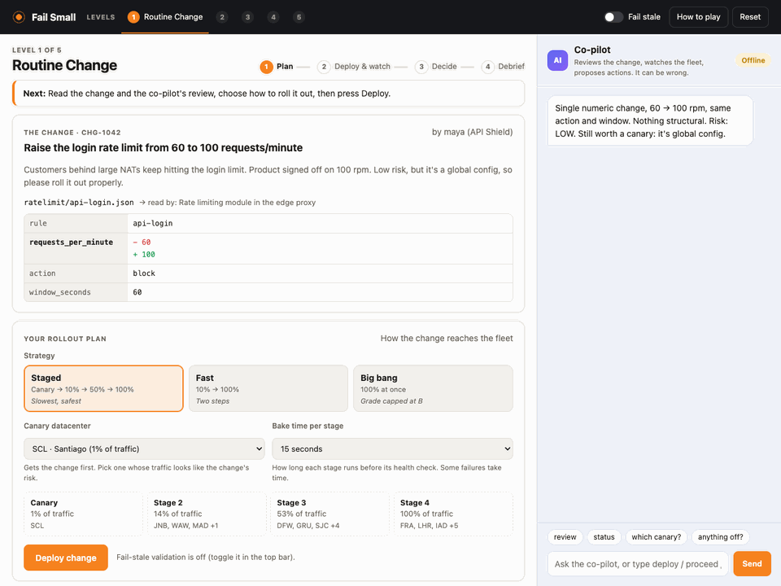
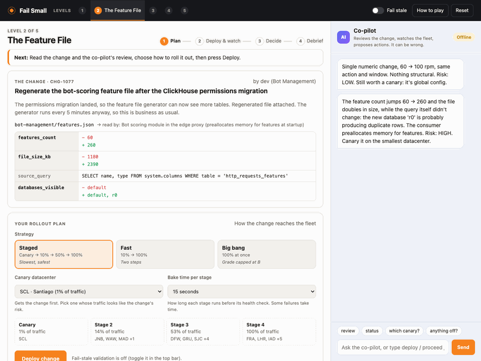
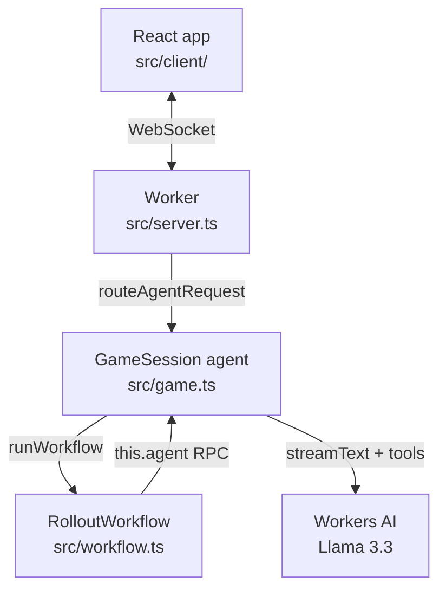
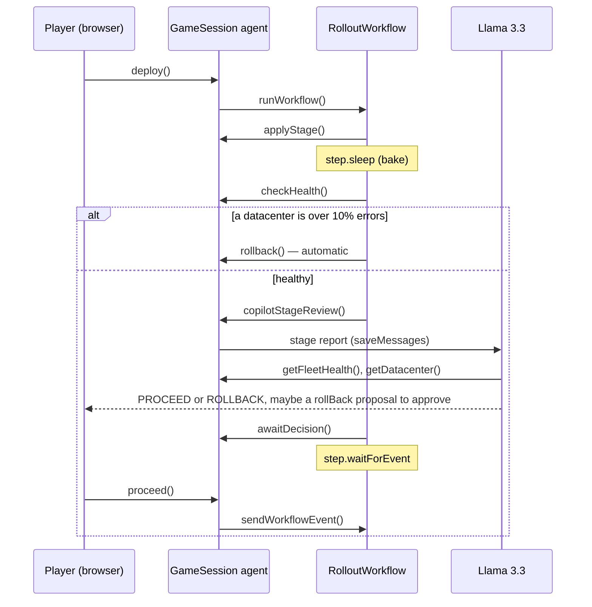

# Fail Small

**A game about shipping config changes without breaking the internet.**



You're the release engineer. Each level is a config change ticket. Pick a rollout plan, deploy it to a simulated
fleet of 20 edge datacenters, and decide at every stage whether to proceed or roll back. An AI co-pilot reviews the
change, watches the fleet with its own tools and can propose actions for you to approve, but it can be wrong.
Your score is the **blast radius**: % of global requests failing × seconds. Keep it small.

I started this after reading Cloudflare's [Code Orange: Fail Small](https://blog.cloudflare.com/fail-small-resilience-plan/)
posts (health-mediated config rollouts, fail-stale defaults, treating config like code) and wanting to feel those
ideas from the release engineer's seat. It turned into a small incident simulator: you rehearse the outages that
start with a routine config push (a bad feature file, a regex that slowly eats CPU, a change that only breaks one
region) somewhere the only thing that goes down is your score. It works as a solo puzzle, as a way to show new SREs
why staged rollouts matter, or as a warm-up before a game day.

## Quick start

```bash
git clone https://github.com/xhoi12/fail-small.git && cd fail-small
npm install
npm start          # opens http://localhost:5173
```

That's it. The game, the agent and the rollout Workflow all run on your machine, and you don't need a Cloudflare
account. Needs Node.js 20.19 or newer.

### Offline co-pilot vs AI co-pilot

The co-pilot is the only part that changes depending on whether you're logged in to Cloudflare. `npm start` checks
and picks the right mode on its own.

| | **Offline co-pilot** (default) | **AI co-pilot** |
|---|---|---|
| What you need | Nothing | A free Cloudflare account |
| Pre-flight review | A scripted review per level | Llama 3.3 reads the diff and writes one |
| Advice after each stage | Simple rule: is anything above baseline? | Llama 3.3 looks at the fleet with its tools and recommends PROCEED or ROLLBACK |
| Proposing actions | No | Can propose a plan change, deploy, proceed or roll back; you approve or reject each one |
| Chat ("why is SYD elevated?") | Commands only (`deploy`, `status`, …) | Free-form questions |
| End-of-level debrief | The level's lesson | A blameless debrief of *your* rollout |
| Badge in the co-pilot panel | `Offline` | `Llama 3.3` |

**To switch on the AI co-pilot** (one-time setup, free, no credit card):

1. **Create a Cloudflare account.** Sign up at [dash.cloudflare.com/sign-up](https://dash.cloudflare.com/sign-up)
   with your email and a password, then verify your email.
2. **Pick a workers.dev subdomain.** New accounts need one before Wrangler can reach Workers AI from your machine.
   In the dashboard, open [**Workers & Pages**](https://dash.cloudflare.com/?to=/:account/workers-and-pages),
   find **Your subdomain**, and set one up (any name; it's free). You don't need to create or deploy a Worker.
   ([Cloudflare docs](https://developers.cloudflare.com/workers/configuration/routing/workers-dev/))
3. **Log in from the terminal.** Run `npx wrangler login`. A browser tab opens; log in with that account and click
   **Allow**. You only do this once per machine.
4. **Start the game.** Run `npm start`. The terminal should say *"co-pilot powered by Llama 3.3 on Workers AI"*,
   and the badge in the co-pilot panel should read **Llama 3.3** instead of **Offline**.

If step 4 can't connect (for example, step 2 was skipped), `npm start` says so and starts with the offline
co-pilot instead.

**Why does it need an account?** Everything else runs locally, but Workers AI models only run on Cloudflare's GPUs,
so during local development the requests the co-pilot makes go to Workers AI using your account. The
[free allocation](https://developers.cloudflare.com/workers-ai/platform/pricing/) (10,000 neurons a day) covers plenty
of games, and nothing gets deployed.

To use the offline co-pilot while logged in, run `npm run dev:offline`.

## How to play

The game shows these rules on your first visit, and they're under **How to play** in the top bar. The screen has
three parts: the **levels** in the dark bar at the top, the **game** in the middle (it follows you through *Plan →
Deploy & watch → Decide → Debrief*, and always says what to do next), and the **co-pilot** chat on the right.

1. **Plan.** Read the ticket and the config diff, and the co-pilot's pre-flight review. Choose a strategy (staged,
   fast or big bang), a canary datacenter that gets the change first, and how long each stage bakes.
2. **Deploy and watch.** Each stage applies the config, bakes, then runs a health check. If any datacenter goes
   over 10% errors, the health gate rolls back on its own.
3. **Decide.** After each stage it's your call: proceed or roll back. The gate only catches big failures, so compare
   with the baseline and ask the co-pilot. You can also type `deploy`, `proceed`, `rollback`, `status` or `review`.
4. **Fail stale** (top bar) makes datacenters validate new configs and keep their last known-good version.

Bad changes must end rolled back; good changes must reach 100%. The grade comes from the blast radius, and big-bang
deploys cap at B because getting lucky isn't engineering.



| # | Level | What it teaches |
|---|-------|-----------------|
| 1 | Routine Change | Not every change is a trap; rolling back a good change is a failure too |
| 2 | The Feature File | Configs are code: validate them, and fail stale ([inspired by Nov 18, 2025](https://blog.cloudflare.com/18-november-2025-outage/)) |
| 3 | Catastrophic Backtracking | Some failures take time to show; bake long enough ([inspired by Jul 2, 2019](https://blog.cloudflare.com/details-of-the-cloudflare-outage-on-july-2-2019/)) |
| 4 | Works On My Region | A canary only proves what it can see |
| 5 | Below The Gate | Automated gates catch big failures, not every failure |

## How it's built

It was also an excuse to try Cloudflare's agent stack end to end, following the structure of the
[chat agent example](https://developers.cloudflare.com/agents/examples/chat-agent/): the
[Agents SDK](https://developers.cloudflare.com/agents/), Workers AI and Workflows.

| Piece | How |
|---|---|
| **Agent** | `GameSession` ([`src/game.ts`](src/game.ts)) extends `AIChatAgent` from `@cloudflare/ai-chat`, so it's an Agent (a Durable Object underneath): one instance per player, routed with `routeAgentRequest` at `/agents/game-session/<player-id>`. |
| **LLM** | Llama 3.3 70B (`@cf/meta/llama-3.3-70b-instruct-fp8-fast`) on Workers AI, through the AI SDK's `streamText` and `workers-ai-provider`. It writes the pre-flight review, reviews each stage, answers questions and writes the debrief. See [`src/copilot.ts`](src/copilot.ts). |
| **Tools** | Read-only tools run on their own (rollout status, fleet health, one datacenter's last 30 seconds, past rollouts). Action tools (change the plan, deploy, proceed, roll back) use `needsApproval`: the player sees an Approve / Reject card first. |
| **Rollouts** | Each rollout is a **Cloudflare Workflow** ([`src/workflow.ts`](src/workflow.ts)) that extends the SDK's `AgentWorkflow`. The agent starts it with `runWorkflow()`, and the workflow calls back through `this.agent`: `step.do` apply → `step.sleep` bake → `step.do` health check → automatic rollback, or `step.waitForEvent` for the player's decision, which the agent sends with `sendWorkflowEvent()`. |
| **Chat** | A React app ([`src/client/`](src/client/)) built with Vite and the Cloudflare Vite plugin. `useAgent` connects to the agent; `useAgentChat` streams the co-pilot's replies, tool calls and approval cards. The buttons call the agent's `@callable()` methods (`deploy`, `proceed`, `rollbackNow`, …). |
| **Memory / state** | Agent state (`setState`, persisted in the agent's SQLite): fleet, last known-good configs, the active rollout, scores, and a memory of past rollouts the co-pilot can look up. `AIChatAgent` keeps the chat in SQLite; the activity log has its own table. |
| **Scheduling** | While a rollout runs, a 1-second `scheduleEvery` task advances the simulation and pushes fleet health to the browser. |

## Architecture



One stage of a rollout, step by step:



- The **agent holds all state**; the **Workflow only coordinates**. Every method the workflow calls checks the
  rollout id and is idempotent, so retried or stale workflow steps can't double-apply a stage or touch a newer
  rollout.
- The browser can only reach the `@callable()` methods, which validate their input; the stage-control methods are
  plain RPC, reachable only by the Workflow. Clients can't write agent state directly either: `validateStateChange`
  rejects any state update that doesn't come from the server, so nobody can hand themselves an S.
- The co-pilot speaks up on its own (pre-flight review, stage reviews, debrief) through `saveMessages()` with a
  hidden prompt message. It waits for the chat to be idle first (`waitUntilStable`), so it never talks over you.
- Rolling back mid-rollout **terminates** the Workflow instance; proceeding sends it an event.
- The simulation itself ([`src/sim.ts`](src/sim.ts)) is pure TypeScript with unit tests: fleet, staging, error
  models (crash, slow burn, regional, subtle), and scoring.

## Design decisions

- **The LLM proposes; the player decides; the gate is deterministic.** The co-pilot can look things up on its own,
  but anything that changes the game needs an Approve click. It never sees the hidden failure mode, so it reasons
  from the same diff and metrics as you, and it can be wrong. Level 5 makes that the point.
- **Stale proposals get withdrawn.** If the co-pilot proposes "roll back" and you press Proceed instead, the proposal
  is marked declined, so an old card can't fire later.
- **Graceful degradation for the AI itself.** If Workers AI is unavailable (offline, not logged in, rate limited),
  the co-pilot falls back to scripted replies for a minute instead of breaking the game. That's fail stale, applied
  to the app.
- **Typed commands skip the LLM.** `deploy`, `proceed` and `rollback` act immediately: typing the command is the
  approval.
- **Co-pilot turns check they're still relevant.** A stage review waits for the chat to go quiet before it posts. If
  the rollout ended in the meantime (or you reset the game), it stays silent instead of advising on a rollout that's
  already over.

## Development

```bash
npm start            # dev server; picks the offline or AI co-pilot for you
npm run dev:offline  # dev server with the offline co-pilot
npm test             # unit + integration tests (no Cloudflare account needed)
npm run typecheck
npm run build        # production build (dist/)
npm run deploy       # build and deploy to your Cloudflare account
```

`npm run deploy` publishes the Worker, the agent and the Workflow to your account; there, the co-pilot runs on
Workers AI natively, with no login step. Set `COPILOT_MODE` to `offline` in [`wrangler.jsonc`](wrangler.jsonc) to
ship the scripted co-pilot instead.

The integration tests ([`test/game.test.ts`](test/game.test.ts)) run the agent and the Workflow inside workerd
with [`@cloudflare/vitest-plugin`](https://developers.cloudflare.com/workers/testing/vitest-integration/). Workflow
sleeps are switched off with `introspectWorkflow`, and Workers AI is swapped for the AI SDK's mock model, so they
cover full rollouts, the health gate, fail-stale, and the co-pilot proposing a rollback that only happens once it's
approved, and a client trying to write agent state directly. CI ([`.github/workflows/ci.yml`](.github/workflows/ci.yml))
typechecks, tests and builds on every push and pull request.

```
src/
  server.ts     Worker entry: routes /agents/game-session/<player> to the player's agent
  game.ts       GameSession (AIChatAgent): state, co-pilot turns, @callable player actions, RPC for the workflow
  workflow.ts   RolloutWorkflow (AgentWorkflow): staged rollout with health gates and player decisions
  copilot.ts    Prompts, tools and the offline fallback
  sim.ts        Fleet, rollout stages, error models, scoring (pure, tested)
  levels.ts     Level definitions
  shared.ts     Types shared by the agent and the client
  client/       React app: navigation, game panels, co-pilot chat
test/           Unit tests (sim) and integration tests (agent + workflow)
PROMPTS.md      AI-assisted development prompt history
```

## Built with AI

I built this pairing with Claude Code. If you're curious how the prompting went, the history is in
[`PROMPTS.md`](PROMPTS.md).

## License

MIT, see [`LICENSE`](LICENSE).
